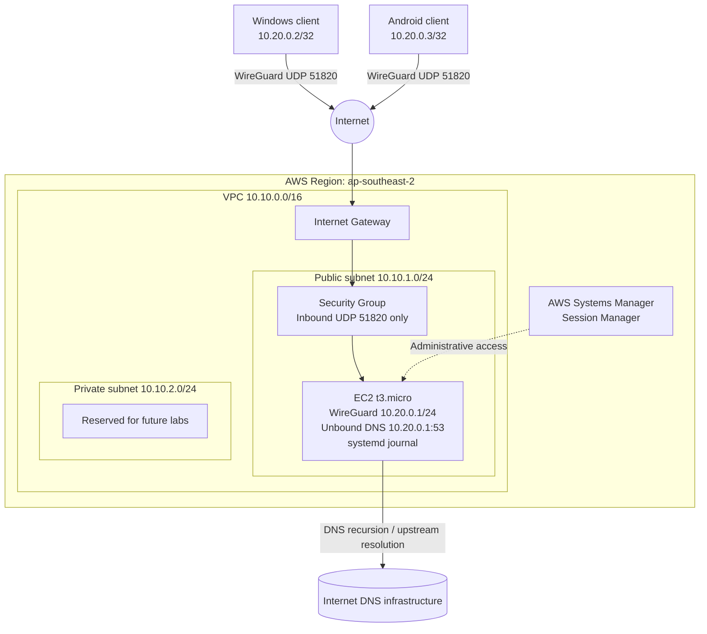

# Building a Secure AWS WireGuard VPN with Private DNS

**A hands-on Cloud Security learning project | AWS • Linux • WireGuard • Unbound • Security Monitoring**

> **Project status:** Operationally validated (21 November 2026). This is a learning lab, not a production-ready VPN service.

## Why I built this

I work in an L1 Security Operations Center (SOC) role and wanted to develop practical cloud security skills by **building and testing infrastructure**, not only reading documentation. My first project was to deploy a small VPN and private DNS service on AWS, then secure it, collect useful logs, troubleshoot connectivity, and verify recovery after a reboot.

My learning objectives were to:

- Understand AWS networking and access controls through hands-on configuration.
- Administer a Linux EC2 instance without exposing SSH to the internet.
- Deploy WireGuard for encrypted access from Windows and Android.
- Run a private DNS resolver reachable through the VPN.
- Generate, inspect, and retain DNS logs for security analysis.
- Test operational resilience instead of stopping when the first connection succeeds.

## Architecture



**Design choice:** This is a **split-tunnel VPN**. The clients route the VPN subnet (`10.20.0.0/24`) through WireGuard and use `10.20.0.1` for DNS. General internet traffic is not tunneled through AWS. The private subnet was provisioned for learning but is not part of the active VPN data path.

### Lab inventory

| Component | Configuration |
|---|---|
| AWS Region | Sydney (`ap-southeast-2`) |
| VPC | `10.10.0.0/16` |
| Public subnet | `10.10.1.0/24` |
| Private subnet | `10.10.2.0/24` (not used by this workload) |
| EC2 | Ubuntu Linux, `t3.micro` |
| Administration | IAM instance role + AWS Systems Manager Session Manager |
| WireGuard server | `wg0`, `10.20.0.1/24`, UDP `51820` |
| Windows peer | `10.20.0.2/32` |
| Android peer | `10.20.0.3/32` |
| Private DNS | Unbound on `10.20.0.1:53` and `127.0.0.1:53` |
| Logging | Unbound query logs through systemd journal |
| Journal policy | Persistent, 100 MB system cap, 32 MB runtime cap, 7-day retention setting |

> **Privacy and security:** Do not publish WireGuard private keys, live client configuration files containing private keys, current public endpoints, AWS account identifiers, instance IDs, or sensitive log data. Values in this README are private lab IPs and illustrative configuration only. Generate your own keys.

## 1. Create the AWS network

Using the **AWS Console**:

1. Create a VPC with CIDR `10.10.0.0/16`.
2. Create a public subnet (`10.10.1.0/24`) and a private subnet (`10.10.2.0/24`).
3. Attach an Internet Gateway to the VPC.
4. Create a public route table with `0.0.0.0/0` pointing to the Internet Gateway, and associate it with the public subnet.
5. Keep the private subnet's route table local-only for this lab; a NAT Gateway is not required.
6. Create a security group with **only inbound UDP 51820** from the internet. Keep SSH (`22`) and DNS (`53`) closed publicly.
7. Launch a small Ubuntu EC2 instance in the public subnet with a public IPv4 address.
8. Attach an IAM instance role with `AmazonSSMManagedInstanceCore`, then connect using **Session Manager** instead of opening SSH.

**Why this matters:** I practiced the difference between routing, subnet placement, and security-group filtering. The Internet Gateway makes the public subnet internet-routable, while the security group restricts inbound traffic to the VPN port.

**Cost note:** EC2, public IPv4 addresses, storage, and optional AWS services may incur charges. Check current pricing and budgets before reproducing the lab. I avoided a NAT Gateway because it was unnecessary for this architecture.

## 2. Install and configure WireGuard

On the EC2 instance, install WireGuard using the package manager appropriate for your Ubuntu release:

```bash
sudo apt update
sudo apt install -y wireguard
```

Generate a unique server key pair securely on the server:

```bash
sudo install -d -m 700 /etc/wireguard
sudo sh -c 'umask 077; wg genkey > /etc/wireguard/server.key'
sudo sh -c 'wg pubkey < /etc/wireguard/server.key > /etc/wireguard/server.pub'
```

Create **separate key pairs** for the Windows and Android clients. The private key for each client stays on that client. Add only the clients' **public keys** to the server configuration.

Example server structure (`/etc/wireguard/wg0.conf`; replace placeholders locally):

```ini
[Interface]
Address = 10.20.0.1/24
ListenPort = 51820
PrivateKey = <SERVER_PRIVATE_KEY>

[Peer]
# Windows
PublicKey = <WINDOWS_PUBLIC_KEY>
AllowedIPs = 10.20.0.2/32

[Peer]
# Android
PublicKey = <ANDROID_PUBLIC_KEY>
AllowedIPs = 10.20.0.3/32
```

Restrict file access, enable forwarding for future routed-network experiments, and enable the service:

```bash
sudo chmod 600 /etc/wireguard/wg0.conf
printf 'net.ipv4.ip_forward=1\n' | sudo tee /etc/sysctl.d/99-wireguard.conf
sudo sysctl --system
sudo systemctl enable --now wg-quick@wg0
sudo wg show wg0
```

> IP forwarding was enabled in this lab, but **full-tunnel NAT and private-subnet routing were not implemented**. The current DNS/VPN use case does not require them.

### Client configuration pattern

For each client, install the WireGuard app, generate its key pair, and configure the peer using the server's **public key** and your EC2 public IPv4 address.

```ini
[Interface]
PrivateKey = <CLIENT_PRIVATE_KEY>
Address = 10.20.0.2/32
DNS = 10.20.0.1
MTU = 1420

[Peer]
PublicKey = <SERVER_PUBLIC_KEY>
Endpoint = <EC2_PUBLIC_IPV4>:51820
AllowedIPs = 10.20.0.0/24
PersistentKeepalive = 25
```

For Android, use `10.20.0.3/32` instead of `10.20.0.2/32`. The endpoint must be updated if the EC2 public IP changes after a stop/start. A stable Elastic IP is an option but can have associated charges.

## 3. Deploy private DNS with Unbound

Install the resolver:

```bash
sudo apt install -y unbound dnsutils
```

Create `/etc/unbound/unbound.conf.d/wireguard.conf`:

```conf
server:
    interface: 127.0.0.1
    interface: 10.20.0.1
    access-control: 127.0.0.0/8 allow
    access-control: 10.20.0.0/24 allow
    access-control: 0.0.0.0/0 refuse
    do-ip4: yes
    do-ip6: no
    hide-identity: yes
    hide-version: yes
```

`do-ip6: no` disables IPv6 transport for the resolver; it does **not** prevent Unbound from returning AAAA records over IPv4 DNS queries.

Validate the configuration and start the service:

```bash
sudo unbound-checkconf
sudo systemctl enable --now unbound
sudo ss -tulnp | grep ':53 '
```

In the validated lab, Unbound listened on `10.20.0.1:53` and `127.0.0.1:53` over UDP and TCP. `systemd-resolved` also used its normal loopback stub addresses. **No Unbound listener was bound to `0.0.0.0:53`**, and the AWS security group did not expose port 53.

## 4. Enable DNS security logging

Create `/etc/unbound/unbound.conf.d/dns-logging.conf`:

```conf
server:
    verbosity: 1
    log-queries: yes
    log-replies: no
    use-syslog: yes
```

Apply the settings:

```bash
sudo unbound-checkconf
sudo systemctl restart unbound
sudo journalctl -u unbound --since '5 minutes ago' --no-pager
```

Example **redacted / representative** query-log format from the lab:

```text
Nov 21 09:31:35 unbound[3554]: info: 10.20.0.2 google.com. A IN
Nov 21 09:33:59 unbound[3554]: info: 10.20.0.1 example.org. A IN
Nov 21 09:40:00 unbound[3554]: info: 10.20.0.3 mtalk.google.com. A IN
```

This creates a simple source of security telemetry: timestamp, querying VPN client IP, requested domain, and DNS record type. It does **not** show the full web page visited, guarantee that a connection occurred, or establish maliciousness.

### Retain logs across reboots

Create `/etc/systemd/journald.conf.d/security-lab.conf`:

```ini
[Journal]
Storage=persistent
SystemMaxUse=100M
RuntimeMaxUse=32M
MaxRetentionSec=7day
```

Then apply and inspect:

```bash
sudo systemctl restart systemd-journald
systemctl is-active systemd-journald
journalctl --disk-usage
```

The lab used **16 MB** of journal storage during validation. The size and retention settings are limits, not a guarantee that every event will be preserved for exactly seven days. Query logging may reveal browsing-related metadata, so it should be used only on systems and devices where collection is authorized, with appropriate access controls and retention.

## 5. Hardening decisions

| Control | Implementation | Security benefit |
|---|---|---|
| Minimal inbound exposure | Only UDP `51820` allowed | Reduces public attack surface |
| No public SSH | Session Manager with IAM instance role | Avoids opening TCP `22` |
| DNS interface binding | `127.0.0.1` and `10.20.0.1` only | Prevents a public-facing DNS listener |
| DNS client ACL | VPN subnet and loopback allowed | Limits who can use the resolver |
| WireGuard peer ACLs | Distinct `/32` per client | Limits peer tunnel IP assignments |
| File permissions | WireGuard configuration `0600` | Protects private-key material |
| Persistent DNS logs | Unbound → journald | Supports later investigation |
| Log retention limits | 100 MB / 7-day configuration | Controls disk consumption |
| Automatic startup | systemd-enabled services | Improves reboot recovery |
| Verified backup | Exact copy of current `wg0.conf` | Supports configuration recovery |

**Scope limitation:** These are lab hardening measures, not a comprehensive production security review. In particular, no automated threat alerting, centralized SIEM ingestion, or disaster-recovery restoration drill was performed.

## 6. Troubleshooting: What went wrong and what I learned

### Issue A — WireGuard traffic failed at first

**Observation:** The client showed an active tunnel, but could not reliably reach `10.20.0.1`.

**Investigation:** Reviewed AWS security group rules, WireGuard logs, and packet captures on the EC2 network interface. An early rule had the wrong UDP port (`5180` instead of `51820`); correcting it enabled successful connectivity over a personal hotspot.

**Lesson:** An application can appear active while a network control blocks the required traffic. Verify each layer: client → network → security group → service → tunnel interface.

### Issue B — Different behavior on office Wi-Fi

**Observation:** The tunnel worked on a personal hotspot but behaved inconsistently on the office network. Packet captures showed some WireGuard handshake packets, but subsequent tunnel traffic was unreliable.

**Conclusion:** The exact root cause was **not established**. Network filtering, endpoint controls, or path behavior were possible contributors. I did not treat this as proof of a specific firewall rule, and I did not attempt to bypass organizational policy.

**Lesson:** A successful handshake does not guarantee end-to-end application traffic. Test from an authorized network and avoid attributing failures without evidence.

### Issue C — Temporary UDP port change

**Observation:** I tested an alternative WireGuard listening port (`4430`), but it did not solve the connectivity problem.

**Resolution:** Returned to UDP `51820` and removed the temporary `4430` security-group rule. Final runtime output confirmed WireGuard listening on `51820`.

**Lesson:** Changing a port does not necessarily resolve network-policy or path restrictions.

### Issue D — AppArmor interfered with WireGuard utilities

**Observation:** `wg-quick strip` and `wg-quick save` encountered failures on the Ubuntu lab instance. AppArmor audit events pointed to a restriction affecting `/usr/bin/bash`.

**Resolution:** Added the narrowly scoped `/usr/bin/bash mr,` permission to the local `wg-quick` AppArmor profile include, reloaded the profile, and verified that `wg-quick strip wg0` succeeded. AppArmor was **not disabled globally**.

**Lesson:** Troubleshooting security controls should prioritize targeted policy changes over disabling protections entirely.

### Issue E — Higher-than-expected latency

**Observation:** Final Windows VPN ping results after reboot showed **0% packet loss**, but an average round-trip time of **476 ms** (370–621 ms across four pings).

**Conclusion:** Functional but high latency; root cause not measured. This remains a performance follow-up, not a completed optimization.

## 7. Validation and evidence

The following checks were performed during the project:

| Validation | Observed result | Outcome |
|---|---|---|
| WireGuard runtime | `wg0`, UDP `51820`, Windows and Android peers | Pass |
| Windows VPN reachability | `ping 10.20.0.1`: 4/4 replies after reboot | Pass |
| Windows private DNS | `nslookup example.com 10.20.0.1` returned A and AAAA records | Pass |
| Android VPN DNS | Unbound recorded queries from `10.20.0.3` | Pass |
| Android browsing | `https://example.com` loaded over mobile data with tunnel enabled | Pass |
| DNS listener exposure | Unbound bound only to loopback and VPN IP | Pass |
| Security group audit | Inbound UDP `51820` only | Pass |
| Backup comparison | `Backup verified: IDENTICAL` | Pass |
| Service startup after reboot | `wg-quick@wg0` and `unbound`: `active` | Pass |
| VPN interface after reboot | `wg0` with `10.20.0.1/24` | Pass |
| Log persistence after reboot | Pre-reboot query entries still retrievable | Pass |
| Android fresh handshake after reboot | Not separately verified | Not tested |
| Production readiness | Not in scope | Not claimed |

**Final Windows test (after reboot):**

```text
Packets: Sent = 4, Received = 4, Lost = 0 (0% loss)
Minimum = 370ms, Maximum = 621ms, Average = 476ms
```

```text
nslookup example.com 10.20.0.1
Server:  UnKnown
Address: 10.20.0.1

Non-authoritative answer:
Name: example.com
Addresses: [IPv6 and IPv4 records returned]
```

`Server: UnKnown` is not a failed lookup: it indicates that a reverse DNS name for the resolver was not available. The domain query itself succeeded.

## 8. What I learned as an L1 SOC analyst

This project helped me connect day-to-day SOC concepts with the infrastructure that produces security events:

- **Network visibility:** I used packet captures and service logs to distinguish handshake activity from usable VPN traffic.
- **Access control:** I applied least-exposure principles through security groups, interface binding, and IAM-based administration.
- **Logging and investigation:** I built a small, queryable DNS event source and verified log survival after reboot.
- **System reliability:** I tested startup behavior and validated a current configuration backup.
- **Evidence-based troubleshooting:** I documented what was observed, what was fixed, and what remains unproven.

## 9. What I would improve next

These are **future work**, not features already deployed:

- Measure latency and packet loss across different authorized networks.
- Add a safe, automated configuration-backup process and perform a restore drill.
- Build CloudWatch / CloudTrail visibility and evaluate centralized security log collection.
- Add DNS alerting or SIEM correlation for suspicious patterns, with privacy safeguards.
- Introduce Terraform for repeatable infrastructure provisioning.
- Evaluate cost, patching, key rotation, and production-grade operational requirements.

## 10. How to reproduce and validate

1. Build the AWS network and EC2 instance described above.
2. Install WireGuard, generate your **own** key pairs, and configure both peers.
3. Install Unbound with VPN-only listening interfaces and access controls.
4. Enable DNS query logging and journal persistence.
5. Confirm the AWS security group exposes only the intended VPN UDP port.
6. Test from an authorized network:

```powershell
ping 10.20.0.1
nslookup example.com 10.20.0.1
```

7. On EC2, inspect the corresponding events:

```bash
sudo wg show wg0
sudo journalctl -u unbound --since '5 minutes ago' --no-pager
```

8. Reboot the instance, verify both services are active, and repeat the client test.
9. Check that a **pre-reboot** journal entry is still available.

## Responsible use

This project is intended for learning, authorized administration, and defensive security monitoring. Respect network policies, user privacy, and applicable logging requirements. Avoid uploading credentials, private keys, or unredacted operational logs to public repositories.

---

**Learning approach:** Build → Observe → Troubleshoot → Harden → Validate → Document.

**Next on my learning roadmap:** AWS security monitoring, threat detection, and eventually DevSecOps automation.
