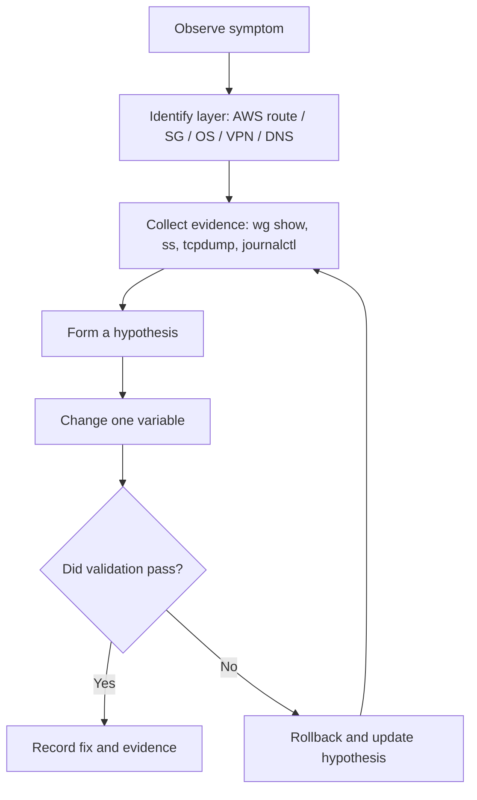

# 05 — Troubleshooting Diary: Mistakes, Evidence, Fixes and Uncertainty

[← DNS](04-unbound-private-dns.md) | [Next →](06-logging-and-hardening.md)

This is the part I most wanted to preserve. The lab did **not** work perfectly on the first try. I recorded what I saw, what I changed, and which conclusions are actually supported.

## Incident 1 — Wrong inbound UDP port

**Symptom:** WireGuard appeared active on the client but the VPN IP did not respond.

**Mistake:** I had opened **UDP 5180** in the AWS Security Group while WireGuard was listening on **UDP 51820**.

**Investigation:** Compare the configured WireGuard `ListenPort`, `ss` output, and AWS Security Group inbound rules; check traffic on the EC2 interface.

**Fix:** Replace the incorrect inbound rule with UDP `51820`.

**Validation:** Windows could reach `10.20.0.1` when using a personal hotspot. **Lesson:** Match the entire network path; a GUI saying “Active” is not proof of successful traffic.

## Incident 2 — Office Wi-Fi vs personal hotspot

**Symptom:** Windows tunnel worked on a personal hotspot, but ping to the VPN IP timed out on office Wi-Fi. Office access to some websites was also restricted.

**Evidence:** On office Wi-Fi, EC2 `tcpdump` saw incoming WireGuard handshake initiation packets and outgoing handshake responses. Windows logs showed at least one response and keypair creation. However, expected ICMP packets did not appear on `wg0` during unsuccessful pings.

**Hypotheses:** Enterprise network filtering, DPI, endpoint/network policy, or another path issue. **Not conclusively proven.**

**Action:** Compared behavior across networks and inspected packets; did not treat the commercial VPN's behavior as evidence that a different WireGuard port would bypass company controls.

**Lesson:** Different networks can behave differently even with identical client configurations. Respect organizational network policies; don't present speculative causes as facts.

## Incident 3 — Experimental UDP 4430 change

**Goal:** Test whether changing the WireGuard listening port altered connectivity.

**Actions:** Temporarily added UDP `4430` to the security group, changed the server's configured and active listen port, and changed the Android endpoint to match.

**Result:** Android connectivity did not improve. The experiment was rolled back to UDP `51820`; the temporary security group rule was later confirmed deleted. `wg show wg0` subsequently confirmed the server listening on `51820`.

**Lesson:** A port number alone does not determine whether a network allows a VPN. Change one variable, validate it, and have a rollback plan.

## Incident 4 — AppArmor interfered with `wg-quick`

**Symptom:** `wg-quick save wg0` and `wg-quick strip wg0` failed with exit status `139` (segmentation fault) on the lab's Ubuntu environment.

**Evidence:** AppArmor audit denials involved `/usr/bin/bash` file mapping under the `wg-quick` profile; there was also a file-inheritance denial related to a terminal device.

**Fix used in lab:** Added a local profile rule for Bash memory mapping:

```text
/usr/bin/bash mr,
```

in `/etc/apparmor.d/local/wg-quick`, then reloaded the relevant AppArmor profile using `apparmor_parser -r`.

**Validation:** `wg-quick strip wg0 > /dev/null` subsequently exited successfully; final `wg-quick strip wg0` reported valid configuration.

**Caution:** This was an environment-specific fix, **not** a universal AppArmor recommendation. Prefer reviewing exact audit denials and minimizing permissions rather than disabling AppArmor globally.

## Incident 5 — DNS client timeout and `Server: UnKnown`

**Symptom:** An early Windows DNS lookup had a short timeout, and `nslookup` displayed `Server: UnKnown`.

**Evidence:** Subsequent queries succeeded, and server logs showed DNS queries. The `UnKnown` label did not prevent A/AAAA responses.

**Resolution:** Confirmed DNS settings, resolver listener and actual responses. No definitive root cause for the transient timeout was established.

## Incident 6 — High VPN latency

**Observation:** Windows pings succeeded with 0% packet loss, but final post-reboot RTT averaged **476 ms** (370–621 ms). An earlier test averaged **395 ms**.

**Status:** Functionality passed; performance needs investigation. We did not collect enough network measurements to attribute the latency to a specific cause.

## My troubleshooting workflow


