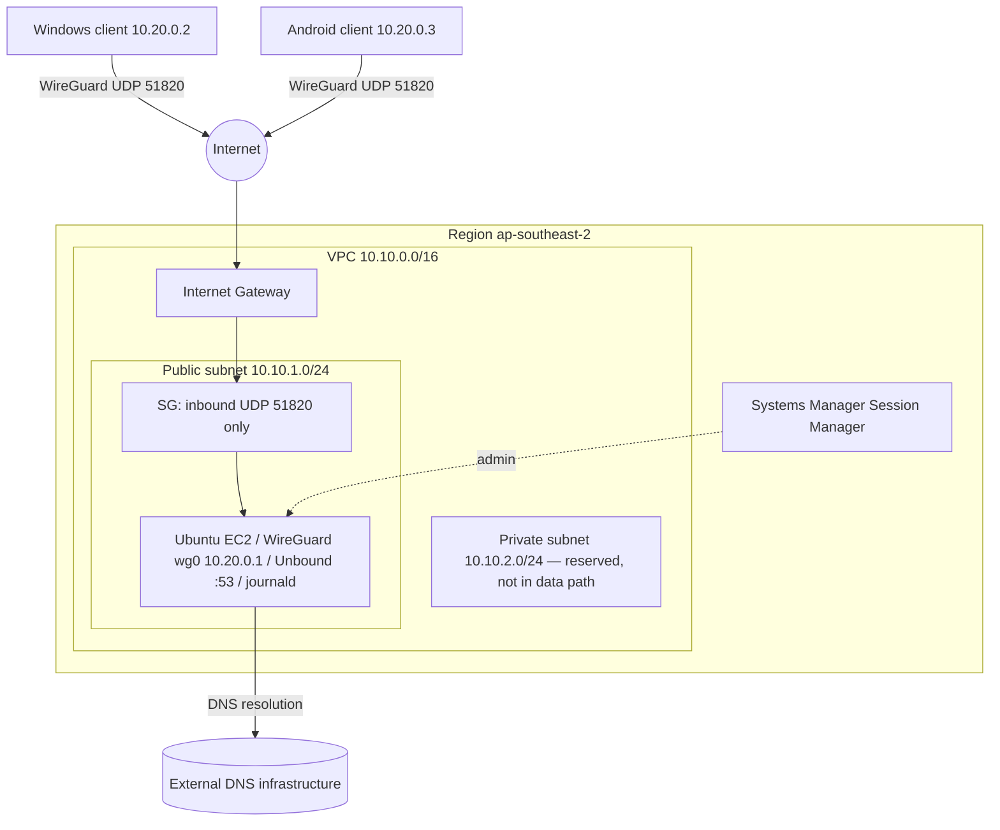

# Project 01 — Building an AWS WireGuard VPN with Private DNS

**Status:** Functional lab validated on 21 November 2026. **Scope:** learning environment, not production deployment.

[← Learning journey](../../README.md) | [Next: AWS networking →](01-aws-network-foundations.md)

## The problem I wanted to solve

As a SOC L1 analyst, I can inspect security logs, but I wanted to understand how the underlying cloud environment is constructed. This lab gave me a reason to configure a network, control access, run Linux services, troubleshoot encrypted traffic, and collect DNS events for investigation.

## Architecture

## Important design decisions

- **Split tunnel:** client `AllowedIPs = 10.20.0.0/24`; only VPN-subnet traffic is routed through AWS. Normal browsing is not carried by this VPN, although DNS queries are sent to the AWS resolver when the client uses it.
- **No public SSH:** administration uses IAM role and Session Manager.
- **No public DNS:** Unbound binds to `127.0.0.1` and `10.20.0.1`, and the security group exposes only UDP 51820.
- **No NAT Gateway:** not needed for this lab; the private subnet is not being used as a routed destination.
- **No production claims:** no high availability, advanced monitoring pipeline, or formal penetration test.

## Environment at a glance

| Item | Lab configuration |
|---|---|
| Region | Sydney, `ap-southeast-2` |
| VPC | `10.10.0.0/16` |
| Public/private subnets | `10.10.1.0/24` / `10.10.2.0/24` |
| EC2 | `t3.micro`, Ubuntu Linux, public subnet |
| Server tunnel | `wg0`, `10.20.0.1/24`, UDP 51820 |
| Peers | Windows `10.20.0.2/32`; Android `10.20.0.3/32` |
| DNS | Unbound on TCP/UDP `10.20.0.1:53` |
| Logs | systemd journal, persistent, configured 7-day / 100-MB policy |

## Reading order

[01 Networking](01-aws-network-foundations.md) → [02 EC2/IAM](02-ec2-iam-linux.md) → [03 WireGuard](03-wireguard-setup.md) → [04 DNS](04-unbound-private-dns.md) → [05 Troubleshooting](05-troubleshooting-diary.md) → [06 Logging/hardening](06-logging-and-hardening.md) → [07 Validation/lessons](07-validation-and-lessons.md)

**Safety:** All keys and public endpoint details are omitted. Generate your own secrets. Costs may apply for EC2, EBS, and public IPv4.
